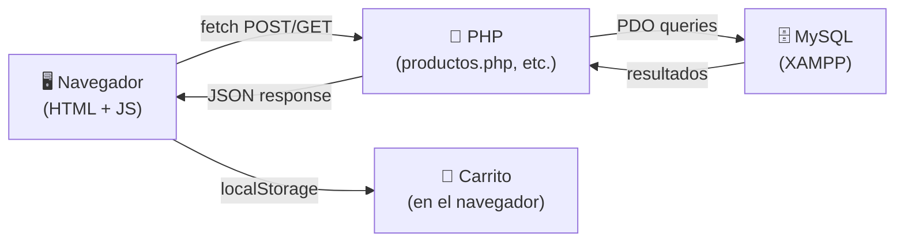

# 🥖 Plan: Pan Clásico (inspirado en FruitByte)

## Resumen de la revisión

### Lo que tiene FruitByte (referencia)
| Aspecto | FruitByte |
|---|---|
| **Backend** | Express (Node.js) puro |
| **Base de datos** | Archivos JSON (`productos.json`, `compras.json`, `contacto.json`) |
| **Auth** | Token estático + bcrypt para login, guardado en `admins.json` |
| **Frontend** | HTML estático + JS vanilla que hace `fetch()` a la API |
| **Páginas** | `index.html` (catálogo), `carrito.html`, `contacto.html`, `login.html`, `admin.html` |
| **CSS** | Un solo `style.css` (~870 líneas), paleta verde/naranja/fresa |
| **Imágenes** | Base64 embebido en el JSON |
| **Deploy** | Render + auto-commit a GitHub |

### Lo que ya tiene Pan Clásico (estado actual)
| Aspecto | Estado |
|---|---|
| **HTML** | ✅ `index.html`, `catalogo.html`, `carrito.html`, `contacto.html` — estructura básica hecha |
| **CSS** | ✅ `styles.css` (~460 líneas) — paleta marrón/dorada de panadería, funcional |
| **JS frontend** | ❌ Todos vacíos: `catalogo.js`, `carrito.js`, `contacto.js`, `app.js`, `inicio.js` |
| **PHP backend** | ❌ Todos vacíos: `config.php`, `productos.php`, `login.php`, `logout.php`, `mensajes.php`, `config/db.php`, `includes/auth.php`, `includes/nav.php` |
| **SQL** | ❌ `database.sql` vacío (fue borrado) |
| **Node.js** | Tiene `server.js` + `config/db.js` + `routes/productos.js` (funcionales con MySQL) |

---

## Diferencias clave: FruitByte → Pan Clásico

| | FruitByte | Pan Clásico (nuevo) |
|---|---|---|
| **Datos** | JSON files en disco | **MySQL** (XAMPP) |
| **API Backend** | Express (JS) | **PHP** (XAMPP Apache) |
| **Servidor** | `node server.js` | **XAMPP** (Apache + MySQL) |
| **Imágenes** | Base64 en JSON | **Archivos en `/img/`** (subidos con PHP) |
| **Tema visual** | Verde/naranja (frutas) | Marrón/dorado (pan) |

---

## Distribución de responsabilidades

### 🐘 PHP (Backend — carpeta `php/`)
Lo que vive en el servidor y habla con MySQL.

| Archivo | Qué hace | Equivalente en FruitByte |
|---|---|---|
| `php/config/db.php` | Conexión PDO a MySQL (`panaderia`) | `leerJSON()` + rutas de archivos |
| `php/includes/auth.php` | Verificar sesión admin (session_start + check) | `verificarToken()` middleware |
| `php/productos.php` | **API** — GET todos, POST agregar, PUT editar, DELETE eliminar | Rutas `/productos` en server.js |
| `php/compras.php` *(nuevo)* | **API** — POST registrar compra, GET historial | Ruta `/comprar` y `/compras` |
| `php/mensajes.php` | **API** — POST guardar mensaje, GET listar | Ruta `/contacto` |
| `php/login.php` | POST login → crear sesión PHP | Ruta `/login` |
| `php/logout.php` | Destruir sesión | Botón "cerrar sesión" |
| `php/subir-imagen.php` *(nuevo)* | Subir imagen a `/img/productos/` | Ruta `/subir-imagen` |

### 📜 JavaScript (Frontend — carpeta `public/js/`)
Lo que corre en el navegador del usuario.

| Archivo | Qué hace | Equivalente en FruitByte |
|---|---|---|
| `js/badge.js` *(nuevo)* | Actualizar contador del carrito en el nav | `badge.js` |
| `js/catalogo.js` | Pedir productos a PHP (`fetch('/php/productos.php')`), renderizar tarjetas, botón "agregar al carrito" | `catalogo.js` |
| `js/carrito.js` | Leer carrito de `localStorage`, mostrar items, controles +/-, enviar compra a PHP | `carrito.js` |
| `js/contacto.js` | Enviar formulario a PHP vía `fetch()` | `contacto.js` |
| `js/admin.js` *(nuevo)* | CRUD de productos desde el panel admin, historial de compras, mensajes | `admin.js` |
| `js/auth-admin.js` *(nuevo)* | Verificar sesión antes de cargar admin, cerrar sesión | `auth-admin.js` |

### 🗄️ SQL (Base de datos)

| Tabla | Campos clave | Equivalente en FruitByte |
|---|---|---|
| `productos` | id, nombre, precio, unidad, descripcion, imagen, stock, categoria, activo | `productos.json` |
| `compras` | id, nombre_cliente, telefono, direccion, metodo_pago, total, fecha | `compras.json` |
| `compras_detalle` | id, compra_id, producto_id, nombre, precio, cantidad | productos dentro de cada compra |
| `mensajes` | id, nombre, email, mensaje, fecha | `contacto.json` |
| `admins` | id, usuario, password_hash | `admins.json` |

### 🌐 HTML (Páginas — carpeta `public/`)

| Página | Descripción | Scripts que carga |
|---|---|---|
| `index.html` | Inicio — hero + tarjetas de info (ya existe) | `badge.js` |
| `catalogo.html` | Catálogo con tarjetas de productos | `badge.js`, `catalogo.js` |
| `carrito.html` | Carrito + formulario de compra + modal tarjeta | `badge.js`, `carrito.js` |
| `contacto.html` | Formulario de contacto (ya existe) | `badge.js`, `contacto.js` |
| `login.html` *(nuevo)* | Login para admin | Script inline |
| `admin.html` *(nuevo)* | Panel admin: CRUD productos + historial + mensajes | `auth-admin.js`, `admin.js` |

---

## Flujo de datos (cómo se conecta todo)

**El flujo es igual que FruitByte**, solo cambia que en vez de leer/escribir archivos JSON, PHP hace queries SQL.

---

## Orden de implementación sugerido

1. ✅ **`sql/database.sql`** — Crear las tablas
2. ✅ **`php/config/db.php`** — Conexión PDO
3. ✅ **`php/productos.php`** — API de productos (GET)
4. ✅ **`js/badge.js`** — Badge del carrito
5. ✅ **`js/catalogo.js`** — Mostrar productos + agregar al carrito
6. ✅ **`catalogo.html`** — Actualizar HTML para las tarjetas
7. ✅ **`js/carrito.js`** — Carrito completo con formulario
8. ✅ **`carrito.html`** — Actualizar HTML con formulario de compra
9. ✅ **`php/compras.php`** — Registrar compras + descontar stock
10. ✅ **`js/contacto.js` + `php/mensajes.php`** — Formulario de contacto
11. ✅ **`php/login.php` + `login.html`** — Auth admin
12. ✅ **`php/includes/auth.php`** — Middleware de sesión
13. ✅ **`admin.html` + `js/admin.js`** — Panel de administración completo
14. ✅ **`css/styles.css`** — Pulir estilos para que se vea como FruitByte pero con tema de panadería

> [!IMPORTANT]
> El `server.js` y `config/db.js` de Node.js **ya no se necesitan** porque todo el backend será PHP en XAMPP. Se pueden conservar como referencia o eliminar.

---

## ¿Listo para empezar?
Dime si quieres que empiece a crear los archivos en este orden, o si quieres ajustar algo del plan primero.
